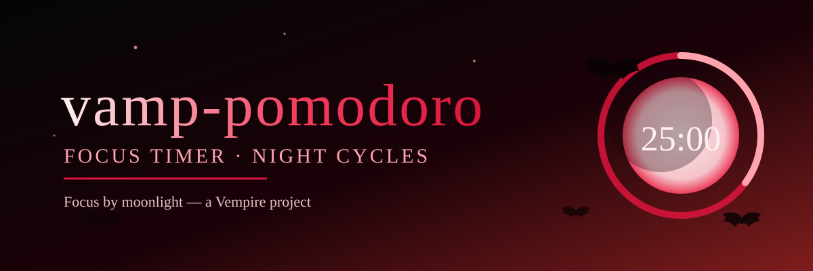

# vamp-pomodoro

A Vempire-themed Pomodoro focus timer with night cycles, session stats, and a built-in task list.

## Features

- Classic Pomodoro cycles: focus, short break, and a long break after every fourth focus session
- Animated progress ring with a bat-and-moon night theme that shifts on breaks
- Session stats: completed sessions, total focus minutes, and current cycle position
- Task list with add, complete, remove, and clear-completed — saved in your browser
- Adjustable focus/break durations and cycle length, applied instantly
- Pure, testable timer logic: `tick()` takes injected elapsed seconds, so no test ever waits on a real clock
- No build step, no dependencies

## Usage

Open `index.html` in a browser (or serve the folder with any static file server).

1. Add tonight's tasks on the right
2. Press **Start** and focus until the ring empties
3. Take the short break; after four sessions the timer offers a long break
4. Use **Next phase** to complete a phase early, or the phase tabs to jump around

## Tests

Requires Node.js 20+.

```bash
node --check app.js
node --test
```

The tests cover cycle transitions (including overflow cascading and the fourth-session long break), time formatting, stats aggregation, and task operations.

## License

MIT — see [LICENSE](LICENSE). Copyright (c) 2026 Lavish Gangwar.
